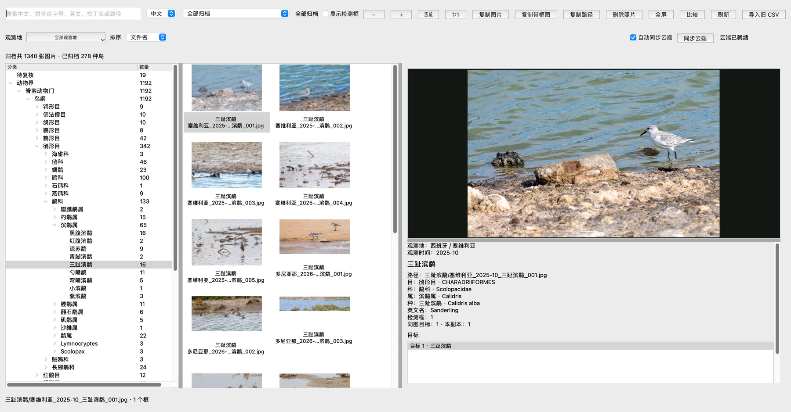
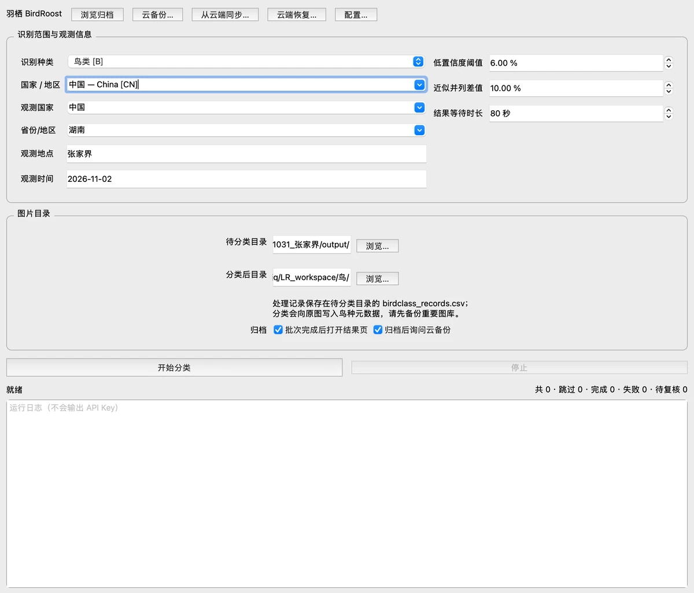
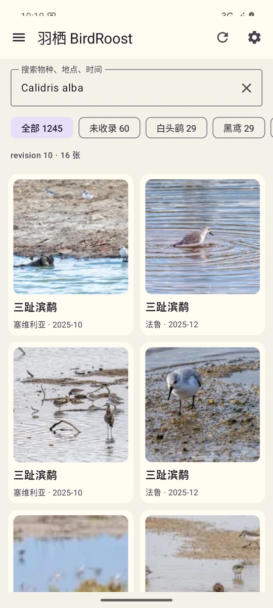
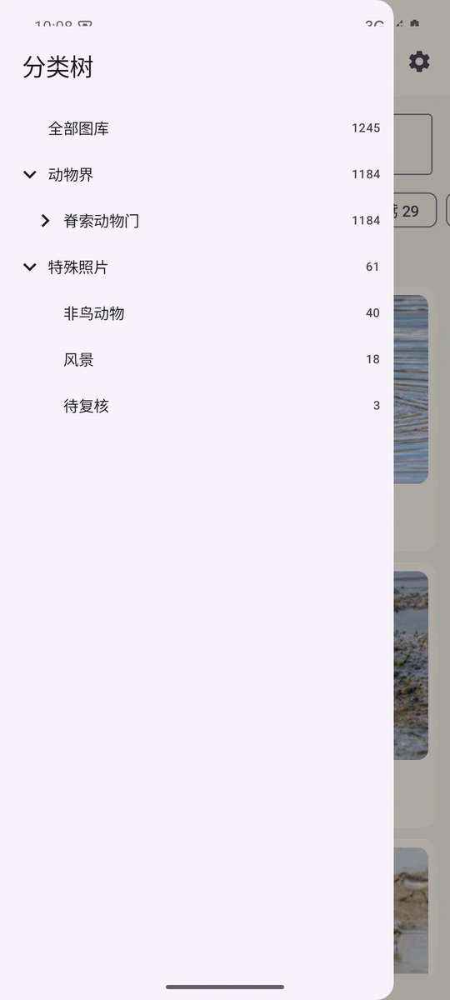
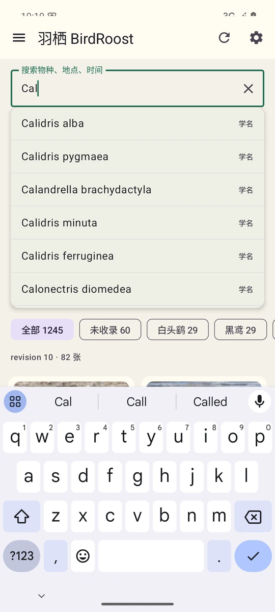

# 羽栖 BirdRoost

**让鸟图按鸟种找到归宿。**

羽栖是一款为观鸟人做的照片整理工具。它不要求你把原图搬进一个全新的相册，而是保留“按地点、按日期存放照片”的习惯，在识别和人工复核之后，为每种鸟生成一份归档副本。

原图留在原处，鸟种有自己的位置。以后想找“今年拍过的鸻鹬”，不用再翻遍每一次出行的文件夹。

[](LICENSE)
[](pyproject.toml)



<p align="center"><sub>桌面端归档浏览：分类树、缩略图和照片详情在同一个窗口里。截图为真实图库。</sub></p>

## 为什么是羽栖

一次观鸟回来，照片通常是这样的：

```text
2026-05_西班牙_塞维利亚/
2026-10_格鲁吉亚_巴统/
2026-11_湖南_张家界/
```

按地点归档很自然，因为拍摄时你就在那里。但当你回看时，问题往往不是“这是哪次旅行”，而是：

> “我想找三趾滨鹬。”
>
> “今年拍过的所有猛禽在哪？”
>
> “这张照片里除了这只，还有没有别的鸟？”

羽栖想解决的就是这个错位：**照片按拍摄场景保存，检索按物种发生。**

AI 负责把大部分明显的照片先认出来，人只需要在模型犹豫的时候做决定。最终归档仍然由你确认，不会悄悄替你改掉一只鸟的名字。

## 一次整理，四步

1. **放进去**：选择这次拍摄的待分类目录，填好观测地点和月份。原图不需要移动。
2. **认出来**：调用懂鸟 API 识别，按检测框处理同一张照片里的多个目标；一张照片里有两种鸟，就分别归档。
3. **过一眼**：置信度低、候选接近，或者你主动选择“稍后处理”时，才进入人工复核。支持“后面同样”、人工鸟名和待复核框标注。
4. **归档、上云**：确认后的副本按 `地点_时间_鸟种_序号` 命名，写入鸟种元数据；需要时再一键生成清单和缩略图，上传到腾讯云 COS。

只有模型拿不准的时候，羽栖才会来打扰你。其余时间，它应该安静地把事情做完。

## 桌面端

### 分类与复核



<p align="center"><sub>分类主界面：识别范围、观测信息、目录和运行日志在一块完成。</sub></p>

- 支持鸟类、哺乳类、两栖类、爬行类，以及按国家／地区缩小识别范围。
- 多目标识别：同一张照片的不同鸟种分别处理，同种只归档一次。
- 低置信度或候选接近时才弹出复核；可把当前选择套用到本图后续目标。
- 候选都不对时，可以直接输入中文鸟名；暂不确认的目标进入 `待复核/`，有检测框时同时生成带框副本。
- 批次中断后可继续，已完成的图片不会重复上传。

### 浏览、搜索与纠错

- 分类树按界、门、纲、目、科、属、种浏览，可切换中文、中英、拉丁显示。
- 搜索支持中文、英文、拉丁名、路径、拼音全拼和拼音首字母；输入时联想，回车跳转。
- 可按观测国家／地区／地点筛选，按文件名、观测时间、修改时间或物种排序。
- 双击照片进入大图，支持缩放、拖动、检测框显示，以及两张照片并排比较。
- 纠错只移动归档副本，不改源图，也不改断点续跑用的 CSV。
- 观测地、观测时间可以单张修改；副本文件名会跟着对齐，避免“元数据和文件名各说各话”。
- 批次结果页点击“矫正完成并关闭”后，按设置询问是否把本批新增内容同步到云端。

更细的功能说明见 [功能清单](docs/功能清单.md)。

## 手机端：只读，但完整

<p align="center">
  
  
  
</p>

<p align="center"><sub>Android 只读客户端：分类树、图库缩略图、物种／地点／学名联想。</sub></p>

手机端不复制一套管理逻辑，也不要求桌面端一直在线。填入只读 COS 配置后，它直接读取：

```text
users/<prefix>/manifest.json
users/<prefix>/thumbs/<sha256>_256.webp
users/<prefix>/originals/<sha256>.<ext>
```

- 分类树浏览，支持非鸟动物、风景、待复核等特殊照片分组。
- 内置 IOC 名录和别名映射，传统中文名也能找到。
- 搜索物种、地点、时间、学名；联想列表不会抢输入焦点。
- 点开看大图，需要时把原图保存到系统相册 `Pictures/BirdRoost/`。
- 没有上传、删除和纠错写操作。手机是一扇窗，不是第二个编辑台。

> Android 客户端目前是 debug 签名，适合自用安装测试。保存到相册需要 Android 10 及以上。

## 云端：一个桶，就是一座图库

羽栖没有账号系统，也没有自建后端。图库的身份就是一组 COS 配置：

```text
Bucket + Region + Endpoint（可选）+ Prefix
```

桌面端把原图按内容 SHA-256 去重，生成 256/512 两种 WebP 缩略图和 `manifest.json`：

```text
users/<prefix>/
├── manifest.json
├── originals/<sha256>.<ext>
└── thumbs/<sha256>_256.webp
    thumbs/<sha256>_512.webp
```

这让几件事情同时成立：

- **增量上传**：云端已存在的对象直接跳过，不重复传大图。
- **新电脑恢复**：下载 manifest 和缺失原图，校验 SHA-256 后重建本地 `.birdroost`。
- **纠错同步**：修改观测信息、鸟种或删除照片后，只更新 manifest 和相关对象，不必重传整个图库。
- **冲突保护**：manifest 带 revision 和 tombstone；多端并发写入时先比较版本，确认后才覆盖。
- **手机只读**：手机只拿 manifest、缩略图和按需下载的原图，不需要桌面端或服务端参与。

`Prefix` 是命名空间，不是权限边界。真正隔离不同用户，仍然要靠私有桶、独立子账号或以后单独的后端。

## 快速开始

### 使用构建包

macOS：

```bash
./packaging/build_macos.sh
```

产物在 `dist/`：

```text
dist/羽栖 BirdRoost.app
dist/羽栖 BirdRoost.dmg
dist/羽栖 BirdRoost-macOS-arm64.zip
```

当前 macOS 构建为 Apple silicon（arm64），使用 ad-hoc 签名。分享到其他 Mac 时，首次打开可能需要右键 → 打开。

Windows 便携包由 `packaging/build_windows.py` 在 Windows 环境构建，产物是 `dist/BirdRoost-Windows-x64.zip`。桌面端目前以 macOS 为主要开发和验证平台。

Android APK：

```bash
cd mobile/android
./gradlew assembleDebug
```

产物为 `app/build/outputs/apk/debug/app-debug.apk`。更完整的 Android 构建说明见 [mobile/README.md](mobile/README.md)。

### 从源码运行

需要 Python 3.11 或 3.12：

```bash
git clone https://github.com/IndanthronBlue/BirdRoost.git
cd BirdRoost
python3 -m venv .venv
source .venv/bin/activate
python -m pip install --upgrade pip
pip install -e .
python -m birdclass
```

Windows 激活虚拟环境使用：

```bat
.venv\Scripts\activate
```

### 第一次使用

1. 打开顶部“配置…”，填入[懂鸟 API Key](https://ai.open.hhodata.com/)。
2. 如果要使用云图库，在“云图库 COS”页填入桶名、地域和用户前缀；SecretId/SecretKey 在[访问管理 CAM 的 API 密钥管理](https://console.cloud.tencent.com/cam/capi)创建。
3. 回到主界面，选择待分类目录和分类后目录，填好观测地点／时间。
4. 点击“开始分类”。批次结束后可以直接打开归档浏览。
5. 需要备份时打开“云备份…”，先生成清单和缩略图，再上传。

密钥可以只放在 macOS 钥匙串或 Android Keystore 里，不写进配置文件，也不会出现在日志中。

## 数据放在哪里

```text
分类后目录/
├── 三趾滨鹬/
│   ├── 塞维利亚_2025-10_三趾滨鹬_001.jpg
│   └── 塞维利亚_2025-10_三趾滨鹬_002.jpg
├── 待复核/
├── 无鸟/
├── 非鸟动物/
├── 风景/
├── 已删除/
└── .birdroost/
    ├── index.sqlite
    ├── groups/
    ├── batches/
    ├── quarantine/
    └── cloud_conflicts/
```

- **原图**：成功归档会向原图写入鸟种元数据，但不会移动、删除或重编码 JPEG。请先备份重要图库。
- **`.birdroost`**：浏览器的归档库。`groups/` 是每个归档组的元数据，`index.sqlite` 是重建出来的检索索引，`batches/` 保存批次；删除后可按现有目录重建，但检测框、批次和纠错历史会丢失。
- **`birdclass_records.csv`**：位于待分类目录，只服务分类断点续跑。运行中不要手工修改；查看器纠错不读写它。
- **云图库**：以 COS 上的 manifest 为准。本机的 `.birdroost` 和 COS 配置共同决定下一次同步的内容。

## 边界与安全

- 没有账号、没有自建后端，也没有多用户权限层。配置即身份，适合个人或小范围自用。
- COS 桶必须是私有桶；手机端请使用只有 `GetObject` / `HeadObject` 权限的只读子账号。
- API Key 和 COS Secret 可选保存在系统钥匙串／Keystore；不要提交到仓库，也不要发到聊天里。
- 图片会作为识别请求的一部分上传到懂鸟服务；使用前请确认你接受它的数据处理方式。
- 多设备同时写同一个 COS 前缀时，羽栖会做 revision 冲突检查，但它不是实时协作系统。

## 技术栈与项目结构

桌面端使用 Python 3.11/3.12、PySide6、SQLite、Pillow 和腾讯云 COS SDK；Android 端使用 Kotlin、Jetpack Compose、OkHttp、Coil 和 Android Keystore。分类学数据内置 IOC World Bird List v15.2 快照。

```text
src/birdclass/          桌面端：识别、归档、浏览、COS 同步
src/birdclass/ui/       PySide6 界面
mobile/android/         Android 只读客户端
packaging/              macOS / Windows 构建脚本
docs/                   需求、开发手册、云端设计、截图
tests/                  单元测试与界面测试
```

相关文档：

- [功能清单](docs/功能清单.md)
- [需求文档](docs/需求文档.md)
- [开发手册](docs/开发手册.md)
- [云端图库技术设计](docs/云端图库技术设计.md)
- [云端图库开发规划](docs/云端图库开发规划.md)

## 开发与测试

```bash
source .venv/bin/activate
pip install -e ".[dev]"
QT_QPA_PLATFORM=offscreen pytest -q
```

测试使用模拟的懂鸟接口，不消耗真实 API 额度。

## 已知限制

- 手机端目前只读，不支持上传、删除或纠错；暂时只有 Android 版本。
- Android APK 是 debug 签名；macOS 构建是 ad-hoc 签名，未做公证。
- 云端同步以 manifest 为中心，不是实时多端协作；并发写入需要人工确认冲突。
- Windows 便携包需要在 Windows 上构建和验证；当前主要在 macOS 上开发和测试。

## License

[MIT](LICENSE) © 2026 Zhang Junqi

欢迎提交 Issue 或 Pull Request，分享你的观鸟和整理工作流。
