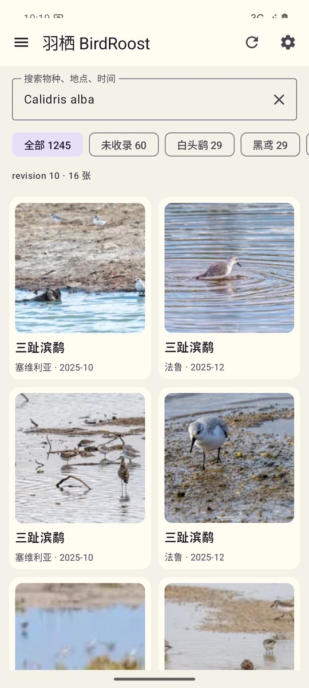
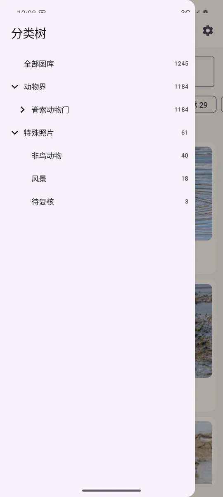

# 羽栖 BirdRoost · Android 只读客户端

把 COS 上的羽栖图库装进口袋。不需要桌面端在线，也不需要后端账号。

<p align="center">
  
  
</p>

## 为什么是只读

整理和纠错留在桌面端，手机负责“看见”。

手机端只申请 COS 的 `GetObject` / `HeadObject` 权限，读取 `users/<prefix>/manifest.json`、缩略图和按需下载的原图。它不会上传、删除或改写云端图库，因此也不需要一个可以写 COS 的长期密钥。

## 能做什么

- 输入只读 COS 配置：Bucket、Region、Prefix、SecretId、SecretKey
- SecretId/SecretKey 使用 Android Keystore + AES/GCM 加密保存
- 读取 `users/<prefix>/manifest.json`
- 分类树抽屉：界／门／纲／目／科／属／种
- 特殊照片单独分组：非鸟动物／风景／待复核
- 传统名、别名映射；例如“北灰鶲”也能落到对应物种
- 按分类节点筛选，按物种／地点／时间／学名搜索
- 内联搜索联想，不抢输入焦点；键盘收起时自动隐藏
- 网格浏览 256 WebP 缩略图，点开查看原图
- 下载原图到系统相册 `Pictures/BirdRoost/`
- 无上传、无删除、无纠错写操作

## 配置只读子账号

在腾讯云 CAM 创建一个子账号，只授予：

```text
cos:GetObject
cos:HeadObject
```

不要给手机端 `PutObject` / `DeleteObject` 权限。COS 桶保持私有；`Prefix` 只是图库命名空间，不是权限边界。

## 构建

需要 JDK 17 + Android SDK 35：

```bash
cd mobile/android
export JAVA_HOME=/path/to/jdk17
export ANDROID_HOME=/path/to/android-sdk
./gradlew assembleDebug
```

APK：

```text
app/build/outputs/apk/debug/app-debug.apk
```

当前 APK 是 debug 签名，适合自用测试，不适合上架。保存原图到相册需要 Android 10 及以上。

## 安装

```bash
adb install -r app-debug.apk
```

打开后填写桶名、地域、用户前缀和只读密钥，点击“保存并读取云端图库”。

完整项目说明见[根目录 README](../README.md)。
